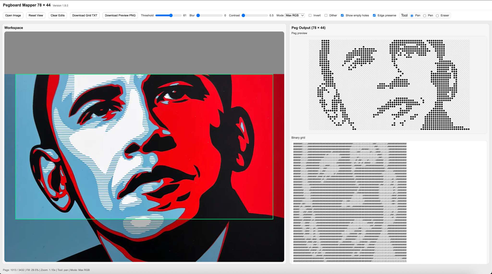
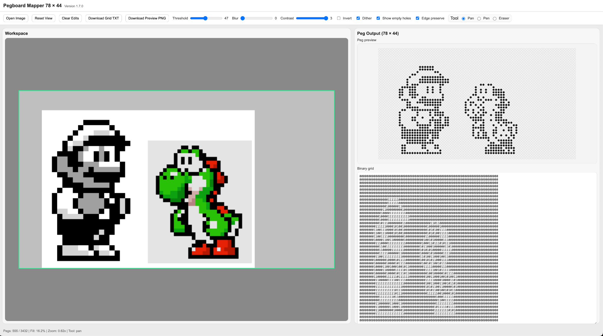
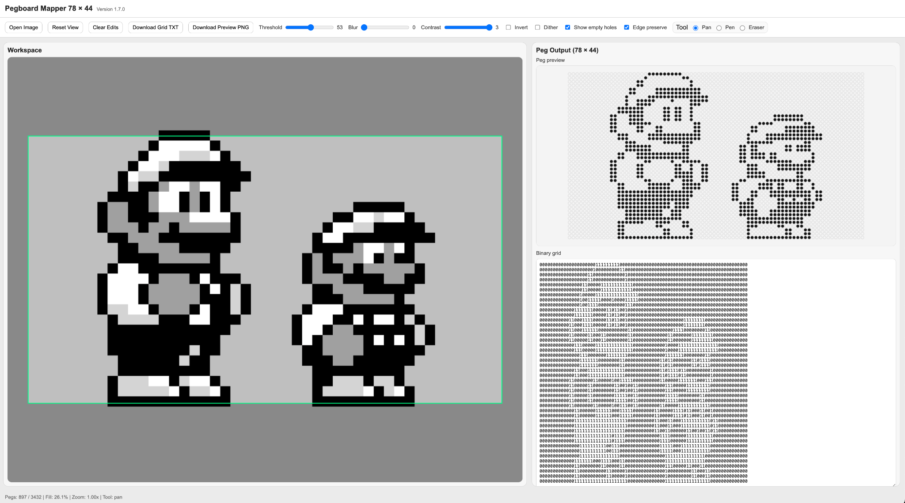

# Pegboard Mapper

**Convert images into binary pegboard patterns.**

Pegboard Mapper turns images into a grid of **pegs (1)** and **empty holes (0)**. The default board is **78 columns × 44 rows** (3,432 positions), but width and height can be changed independently. Choose how the source image is interpreted, refine the result, and export a placement pattern.

## Install the browser version (recommended)

1. Install [Tampermonkey](https://www.tampermonkey.net/).
2. **[Install Pegboard Mapper](https://raw.githubusercontent.com/penguin-zoo/pegzel/main/pegboard-mapper.user.js)**.
3. Open any regular HTTP or HTTPS website, open the **Tampermonkey menu**, then choose **Open / close Pegboard Mapper**.

The userscript uses a general HTTP/HTTPS match only to register a launch command. **It does not automatically take over webpages**, and image processing runs locally in your browser.

### Pegboard Mapper v2.0

The browser and Python desktop editions now support:

- **Custom grid size:** 1–200 columns and 1–200 rows, default 78 × 44
- **Binary mode:** 0 is empty; 1 is a peg (original behaviour)
- **Multi-colour mode:** indexes **1–20** select peg colours from the user-defined palette; choose **Full board** (default, no empty holes) or **Threshold** (0 indicates an empty hole)
- **Custom peg palettes:** colour pickers for your real peg colours; the browser also includes an automatic palette sampler
- **Placement exports:** TXT, CSV and JSON, with a PNG peg preview
- **Colour inventory:** the browser displays counts per colour; JSON includes colour counts

In multi-colour **Full board** mode, every position gets the nearest palette colour, with exactly width × height pegs. Multi-colour **Threshold** mode uses the threshold to decide whether each cell is empty or filled. A filled position gets its closest configured peg colour. In Full board mode the eraser is disabled to preserve complete coverage. In the browser, the **Dither** control currently affects peg occupancy rather than distributing colour error. Output from Python and browser may still differ because their processing pipelines are not identical.

**JSON format:** The common 'pegzel-grid-v2' structure contains 'width', 'height', 'mode', 'palette', 'grid', and 'counts'. Rows contain integer indices, not colour names. The palette is zero-based in JSON, so **grid value 1 uses palette[0]**. JSON includes `occupancy` (`full` or `threshold`) for v2.1 exports. 'counts[0]' is the number of empty holes.

### Browser features

- Open an image or drop one into the workspace
- Drag to position and use the scroll wheel to zoom
- Control threshold, blur, contrast, invert, dithering, and edge preservation
- Interpret source images using luminance, red, green, blue, or maximum RGB
- Choose output board size, binary or multi-colour output, and a palette of up to 20 colours
- Generate an automatic colour palette from the loaded source image
- Export TXT, PNG, CSV or JSON
- Draw or erase individual pegs, with manual overrides retained across processing changes
- Preview the circular pegs and empty holes
- Export a binary text grid and a PNG preview

A channel selection only changes **how input colours become a binary pattern**; the output is always peg/no peg.

## Run the Python desktop version

The Python implementation is in **[pegboard_mapper.py](pegboard_mapper.py)**.

You will need a Python installation with **Tkinter** support. On some installations, Tkinter is supplied by the operating system or Python installer and cannot be added with pip alone.

```bash
python -m pip install -r requirements.txt
python pegboard_mapper.py
```

For optional drag-and-drop support:

```bash
python -m pip install tkinterdnd2
```

Without `tkinterdnd2`, use **Open Image**. The Python desktop version supports file opening, pan and zoom, adjustable grid dimensions, up to 20 manually selected peg colours, source-channel selection, thresholding, blur, contrast, binary dithering, manual pen/eraser editing, and exporting TXT/PNG/CSV/JSON. The Python colour mode currently assigns nearest palette colours without colour dithering. The two editions are **not pixel-for-pixel equivalent**, and the browser build remains the recommended version.

## Grid format

In binary mode, a text export begins with a dimensions header and contains one binary row per line:

```text
78x44

000000...000
001110...000
...
```

In binary mode, `1` means a peg is present; `0` means the hole is empty. In colour TXT files, values are separated by spaces (`00` for empty, `01`–`20` for the palette index). CSV and JSON preserve numeric indices.

## Example conversions

These examples were created with **Pegboard Mapper**, reinterpreting familiar imagery as arrangements of binary pegs on a **78 × 44** grid. They are outputs of the mapping process, **not copies of the source artwork**.

| Barack Obama — HOPE interpretation | Mario & Yoshi interpretation | Mario pixel-art interpretation |
|:---:|:---:|:---:|
|  |  |  |
| Portrait source converted into peg/no-peg positions | Familiar game imagery converted into binary dots | A further example of pixel-art simplification |

### Source artwork and characters

These screenshots demonstrate **Pegboard Mapper's generated binary interpretations**. The underlying source imagery and recognisable characters are associated with their respective rights holders:

- **Barack Obama “HOPE”** — original poster artwork by Shepard Fairey (2008), based on a photograph by Mannie Garcia.
- **Mario, Luigi and Yoshi** — characters associated with Nintendo. The specific source-sprite illustrators have not been identified.

This software is independent and is not affiliated with or endorsed by any of these rights holders. Its software licence does not grant rights in third-party characters or source imagery.

## Project and releases

**Pegboard Mapper** is the application name. The GitHub repository name is a source-code location, not part of the application's branding.

This is an experimental image-to-pegboard conversion tool. The Python and browser interfaces may differ in details of filtering and colour conversion. Please report defects and suggestions using GitHub Issues.

## Licence and third-party artwork

See [LICENSE](LICENSE) for the licence covering original source code. The source-code licence does **not** apply to third-party artwork, character designs, trademarks, or example images owned by others.

## Discoverability

Image-to-pegboard converter · Pegboard pattern generator · Binary art · Pixel-art mapper · Tampermonkey userscript · Python image conversion
